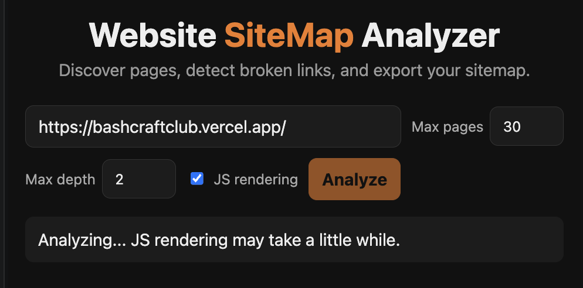
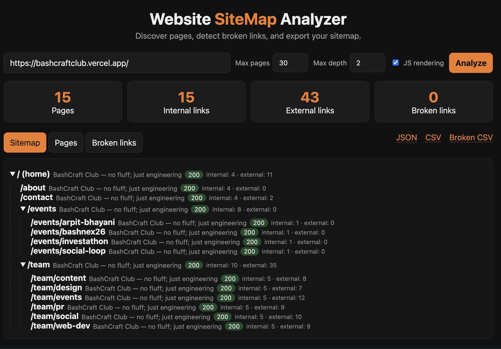

# Website SiteMap Analyzer

A web-based tool that crawls a website, discovers its internal pages, detects broken links, and generates a structured sitemap that can be exported as JSON or CSV.

Built for the **BashCraft Web Development Recruitment Task**.
Demonstrated on: **https://bashcraftclub.vercel.app/**

## Features

- URL input with validation and clear error messages
- Internal page discovery using a breadth-first crawler
- URL normalization and duplicate handling (also prevents crawl loops)
- Internal vs. external link separation (external sites are never crawled)
- Broken-link detection with HTTP status or failure reason
- "Restricted" category for links that block bots (e.g. LinkedIn 999/429), so they are not falsely reported as broken
- Interactive sitemap tree, plus searchable and sortable Pages and Broken Links tables
- Summary statistics (pages, internal links, external links, broken links)
- Export as JSON, CSV, and a separate broken-link CSV
- Crawl controls: max pages and max depth
- JavaScript rendering support (Playwright), because many modern sites generate links with JS
- Respects `robots.txt`, with a small delay between requests

## Tech Stack

- **Backend:** Python 3, Flask
- **Crawling:** requests, BeautifulSoup4, Playwright (Chromium)
- **Frontend:** HTML, CSS, vanilla JavaScript
- **Testing:** pytest (56 automated tests)

## Prerequisites

- Python 3.9 or higher
- Git (to clone the repository)
- About 150 MB of free space for the Chromium browser used by Playwright

## Installation

```bash
# 1. Clone the repository
git clone https://github.com/codesbychandan/bashcraft_sitemap.git
cd bashcraft_sitemap

# 2. Create and activate a virtual environment
python3 -m venv venv
source venv/bin/activate          # Windows: venv\Scripts\activate

# 3. Install dependencies
pip install -r requirements.txt

# 4. Download the Chromium browser used for JS rendering
playwright install chromium
```

## Running the App

```bash
python app.py
```

Open **http://127.0.0.1:5001** in your browser.

## How to Use

1. Enter a website URL (the BashCraft URL is pre-filled).
2. Set **Max pages** and **Max depth** if needed.
3. Keep **JS rendering** checked for JavaScript-driven sites. Untick it for faster crawling of plain HTML sites.
4. Click **Analyze** and wait. JS rendering takes roughly a few seconds per page.
5. Explore the results:
   - **Sitemap** tab: page hierarchy as a tree
   - **Pages** tab: search by title/URL, click column headers to sort
   - **Broken links** tab: broken links with status/reason and the page they were found on
6. Export using the **JSON**, **CSV** or **Broken CSV** links.

## Running the Tests

```bash
python -m pytest -v
```

The tests use mocked network responses, so they run offline. See [docs/TESTING.md](docs/TESTING.md).

## Demo on the BashCraft Website

**URL analyzed:** https://bashcraftclub.vercel.app/ (max depth 2, max pages 30, JS rendering on)

| Metric | Result |
|---|---|
| Pages discovered | 15 |
| Internal links | 15 |
| External links | 43 |
| Broken links | 0 |
| Restricted links (bot-blocked) | 35 (LinkedIn 999/429) |

Discovered structure: `/`, `/about`, `/contact`, `/events` (4 event pages), `/team` (6 team pages).




## Project Structure

```
├── app.py                 # Flask server and export routes
├── crawler.py             # Crawling, link classification, broken-link checks
├── utils.py               # URL validation and normalization
├── templates/index.html   # Page layout
├── static/                # style.css, script.js
├── tests/                 # pytest test suite
├── docs/                  # Technical docs, testing docs, screenshots
└── requirements.txt
```

## Documentation

- [Technical documentation](docs/TECHNICAL.md): architecture and design decisions
- [Testing documentation](docs/TESTING.md): test cases and edge cases

## Known Limitations

- **Single user:** the last result is stored in server memory, so exports always return the most recent analysis. Concurrent users would overwrite each other.
- **Slow requests:** the crawl runs inside one HTTP request. Large sites or JS rendering can take a while, and there is no live progress bar.
- **Subdomains are external:** `blog.example.com` is treated as a different site from `example.com`. Only `www.` is treated as the same site.
- **Query strings are kept:** `/page?a=1` and `/page?a=2` count as different pages. Query parameters are not sorted or stripped.
- **No `sitemap.xml` parsing:** pages are discovered only by following links.
- **Single-page apps share one title:** the BashCraft site returns the same `<title>` for every route, so all pages show the same title. The tool shows each page's path to tell them apart.
- **Bot-blocking sites:** sites like LinkedIn return 403/429/999 to bots. These are reported as "restricted", not broken, and cannot be verified.
- **Links that appear only after user interaction** (clicks, infinite scroll, logins) are not discovered.
- **Non-HTML files** (PDF, images, etc.) are status-checked but not parsed.
- **Development server:** Flask's built-in server is used. It is not intended for production deployment.
- **Pages beyond max pages or max depth** are not crawled. Links found on them are still status-checked.
- **No real-time crawl cancel:** a running crawl cannot be stopped from the UI.

## License

Created as a recruitment task submission.